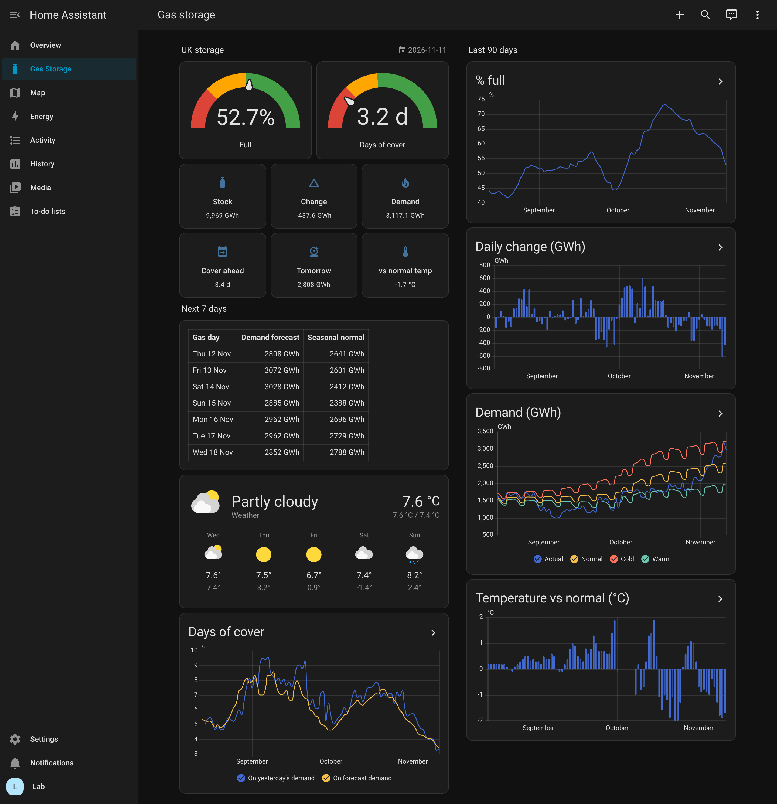
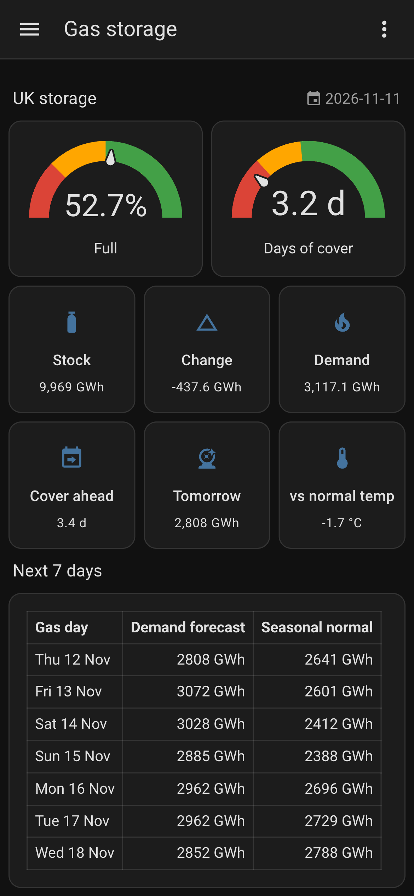
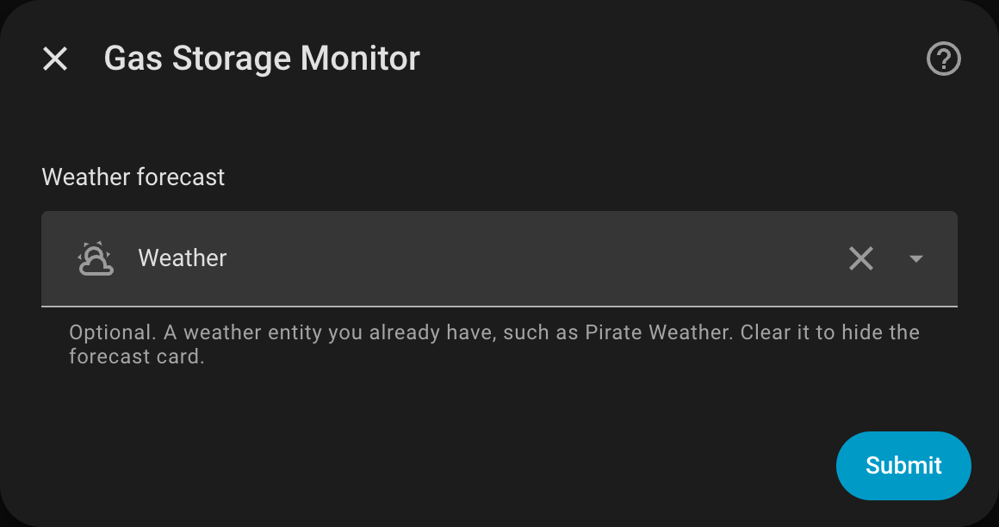

# Gas Storage Monitor

National gas storage levels and days of cover for Home Assistant.

Data comes from the [National Gas operational data API](https://apideveloper.nationalgas.com/s). You don't need an API key. Built for HA Container. It adds no pip packages and makes no Supervisor calls.



## Sensors

| Entity | Unit | Source |
|---|---|---|
| `sensor.gas_storage_monitor_stock` | GWh | PUBOBJ330 aggregated stock |
| `sensor.gas_storage_monitor_percent_full` | % | PUBOB2050 medium-range storage |
| `sensor.gas_storage_monitor_rough_percent_full` | % | PUBOB2046 long-range (Rough) |
| `sensor.gas_storage_monitor_demand_previous_day` | GWh | PUBOB637 NTS demand, D+1 (mscm × 10.97) |
| `sensor.gas_storage_monitor_days_of_cover` | d | stock ÷ previous-day demand |
| `sensor.gas_storage_monitor_days_of_cover_forecast` | d | stock ÷ average forecast demand, next 7 days |
| `sensor.gas_storage_monitor_stock_change` | GWh | stock minus previous day's stock (negative = withdrawal) |
| `sensor.gas_storage_monitor_demand_forecast` | GWh | tomorrow's forecast; `forecast` attribute holds 7 days (PUBOB690 … PUBOBJ2342) |
| `sensor.gas_storage_monitor_demand_normal` / `_cold` / `_warm` | GWh | seasonal normal, cold and warm demand for the same gas day as actual demand |
| `sensor.gas_storage_monitor_temperature_vs_normal` | °C | today's forecast temperature minus seasonal normal (PUBOBJ507, PUBOBJ510) |
| `sensor.gas_storage_monitor_gas_day` | date | gas day of the stock figure |

All demand figures use National Gas's volume data (mscm), converted at a fixed 10.97 GWh per mscm, so actual, forecast and seasonal demand compare like with like. The energy item PUBOBJ1030 is not used: it leaves out part of demand (likely exports and storage injection), so its ratio to volume swings from 6 to 10 through the year.

Each figure has a `gas_day` attribute. Stock is published daily at about 15:30. The integration polls every hour. On first setup it also imports the last 90 days into long-term statistics, so the trend graphs start out full.

## Dashboard

The integration adds a **Gas Storage** dashboard to the sidebar (`/gas-storage`). It's built from `dashboard.yaml` using built-in cards only, so it's read-only in the UI and updates along with the integration. To customise it, copy that YAML into a dashboard of your own.

It works on phones too:



### Weather forecast (optional)

During setup, or later under **Configure**, you can choose a weather entity you already have (Pirate Weather, Met Office, Met.no, …). Its daily forecast is then shown on the dashboard next to the demand forecast. Clear the field to hide it.



## Install

Requires Home Assistant 2025.11 or newer.

**Marketplace** (Settings → Marketplace):

1. Select **Add from link** and paste `https://github.com/vechiato/ha-gas-storage-monitor`.
2. If asked, connect GitHub. This happens once, only on installs that never had HACS, and only reads public data.
3. Open **Gas Storage Monitor**, select **Install**, then **Set up**.

**HACS** (Home Assistant without the Marketplace): add `https://github.com/vechiato/ha-gas-storage-monitor` as a custom repository with category *Integration*, install it, restart Home Assistant, then add **Gas Storage Monitor** under Settings → Devices & services.

**Manual:** copy `custom_components/gas_storage_monitor/` into your `config/custom_components/` folder, restart Home Assistant, then add **Gas Storage Monitor** under Settings → Devices & services.

## Updating

Install the new version from the Marketplace or HACS, then restart Home Assistant. A restart is needed because Home Assistant only loads an integration's code when it starts.

If you rename the integration's entities, or Home Assistant renames them (for example adding the area name when you choose an area during setup), the dashboard follows: reload the integration under Settings → Devices & services → Gas Storage Monitor → ⋮ → Reload.

## Self-check

`python3 custom_components/gas_storage_monitor/api.py` tests the parser against a canned response.

## Development lab

Throwaway HA in Podman. The integration folder is mounted read-only, so restart the container after you change the code.

```sh
mkdir -p lab/config
podman run -d --name hass-lab -p 8123:8123 -e TZ=Europe/London \
  -v "$PWD/lab/config:/config" \
  -v "$PWD/custom_components/gas_storage_monitor:/config/custom_components/gas_storage_monitor:ro" \
  ghcr.io/home-assistant/home-assistant:stable
podman exec -i -e PW=<password> hass-lab python3 - < lab/smoke.py   # onboard, add integration, check sensors + dashboard
podman restart hass-lab                                            # after code changes
```
